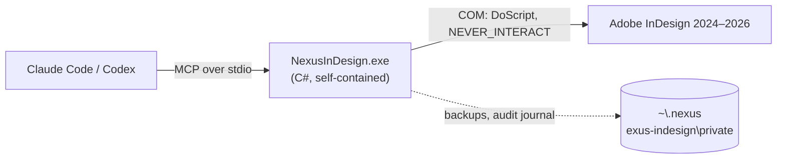

<div align="center">

<a href="https://julienpiron.fr/nexusindesign/"></a>

# NexusInDesign

**InDesign, driven by your AIs. No panel, no network.**

Adobe InDesign 2024 to 2026 for Claude Code and Codex, through one native Windows engine and InDesign's own COM
automation: every change checked, every document backed up first, every export verified.

[](https://github.com/pironjulien/NexusInDesign/actions/workflows/tests.yml)
[](https://scorecard.dev/viewer/?uri=github.com/pironjulien/NexusInDesign)
[](https://www.bestpractices.dev/projects/16438)
[](https://github.com/pironjulien/NexusInDesign/releases/latest)
[](#-quick-start)
[](#-quick-start)
[](https://modelcontextprotocol.io)
[](LICENSE)

[](https://apps.microsoft.com/detail/9NSH2P3QLWT1)

[🌐 Website](https://julienpiron.fr/nexusindesign/) · [📦 Get it with NexusSystem](https://github.com/pironjulien/NexusSystem) · [📝 Changelog](CHANGELOG.md)

</div>

## ✨ Why NexusInDesign

<table>
<tr>
<td width="33%">🧩 <b>COM automation only</b><br>UXP scripts run by <code>DoScript</code> under <code>NEVER_INTERACT</code>: no panel, no Adobe UXP plugin, no Node.js, no Computer Use.</td>
<td width="33%">💾 <b>Backed up, undone in one step</b><br>Every open document is backed up before a change, and a script's changes are removed by a single undo.</td>
<td width="33%">✅ <b>Checked and verified</b><br>Each change is checked against the document's revision and state token; every PDF, PNG, IDML and INDD export is verified.</td>
</tr>
<tr>
<td>🖼️ <b>One pass, one preview</b><br><code>run_layout_script</code> checks, backs up, runs, saves and returns a verified PNG preview with the new revision.</td>
<td>🔒 <b>Nothing leaves the PC</b><br>No network listener; the engine talks over stdio and sends nothing over the network.</td>
<td>⚡ <b>Native and self-contained</b><br>One C# engine, <code>NexusInDesign.exe</code>, x64 and ARM64, no administrator rights. 32 tools.</td>
</tr>
</table>

## 🚀 Quick start

Windows (x64 or ARM64), InDesign 2024 to 2026 installed (it registers its COM server), Claude Code and/or Codex.

> [!TIP]
> **Let your AI install it.** Paste this sentence into **Claude Code** or **Codex**:
>
> ```text
> Install and set up NexusInDesign for me by following https://raw.githubusercontent.com/pironjulien/NexusSystem/main/INSTALL-AI.md
> ```

**Or the NexusSystem app** ([Microsoft Store](https://apps.microsoft.com/detail/9NSH2P3QLWT1)): it runs this
product's `get.ps1` and adds the `nexus-indesign` plugin to Claude Code and Codex from the Nexus catalog. Restart
Claude Code and Codex afterwards.

<details>
<summary><b>Manual install (verified)</b></summary>

Download `get.ps1` and `SHA256SUMS.txt` from the [latest release](https://github.com/pironjulien/NexusInDesign/releases/latest),
check the hash (and `gh attestation verify get.ps1 --repo pironjulien/NexusInDesign --signer-repo pironjulien/NexusSystem`),
then run the file:

```powershell
powershell -NoProfile -ExecutionPolicy Bypass -File .\get.ps1
```

It installs `%USERPROFILE%\.nexus\nexus-indesign\NexusInDesign.exe` (no administrator rights), the path both plugins
start: a small native launcher that runs the engine of the current version from `versions\<version>-<hash>\`, a folder
never modified once written, so a conversation already open keeps working through an update. Run it again to update; `-Remove` removes the program and keeps backups and the audit journal. Claude Desktop
can also use the MCP bundle (`nexus-indesign-<version>-win-x64.mcpb` or `-win-arm64.mcpb`) of each release.

</details>

The engine starts InDesign when needed and closes it again if it started it hidden and nothing stays open.

## ⚙️ How it works



The `nexus-indesign` skill (in [`plugin/skills`](plugin/skills)) guides the agent:

1. `silent_status`, `silent_list_documents`, then `open_document` or `create_document`: each returns `documentId`,
   `revision` and `stateToken`.
2. **`run_layout_script`** for every coherent change: in one tracked InDesign pass it checks revision and state token,
   backs up every open document (restorable with `silent_restore_backup`), runs the UXP script (`app`, `indesign`,
   `doc`, `input`), saves if asked, renders a verified PNG preview and optionally closes. It returns the new revision
   and token, so calls chain without re-inspection; a failing script is a known outcome with its backup.
3. `preflight_document`, then `finalize_layout` (PDF only if the layout contract and Adobe's preflight pass) or
   `export_pdf`, `export_png`, `export_idml`, `package_document`, `save_document`, `save_as`.
4. `silent_close_document` for the documents the task opened.

Other tools: `analyze_layout` and `compare_layout_snapshot` (geometry, resources, styles, lint and a stable layout
fingerprint), `preview_layout`, `create_working_copy`, `silent_audit_document` and the `get_*` reads,
`execute_uxp_silent`, `indesign_doctor` (local checks, never starts InDesign) and `search_official_dom` (offline index
of Adobe's official DOM reference, pinned by SHA-256). 32 tools in all.

> [!IMPORTANT]
> After a timeout or a crash, `silent_operation_status` tells what is known; every InDesign command stays refused until
> `silent_reconcile_unknown_operation` has proven the documents stable and backed them up (it asks for a full InDesign
> restart when the interrupted script could still resume).

> [!WARNING]
> Code run through `run_layout_script` and `execute_uxp_silent` has Adobe's full scripting permissions (files and
> network included): it is not a sandbox.

## 🛠️ Settings

Defaults suit most users: documents are read from and written to the user profile; private storage, `~\.nexus`,
`.ssh`, `.gnupg` and AppData are denied.

<details>
<summary><b>Change the allowed folders and limits</b></summary>

Create `%USERPROFILE%\.nexus\nexus-indesign\settings.json`:

```json
{
  "readRoots": ["C:\\Dev", "%USERPROFILE%\\Documents"],
  "writeRoots": ["C:\\Dev", "%USERPROFILE%\\Documents"],
  "deniedRoots": ["%USERPROFILE%\\Documents\\Secrets"]
}
```

Environment variables take precedence: `INDESIGN_MCP_READ_ROOTS`, `INDESIGN_MCP_WRITE_ROOTS`,
`INDESIGN_MCP_DENIED_ROOTS` (`;`-separated), `INDESIGN_MCP_COMMAND_TIMEOUT_MS` (default 120000),
`INDESIGN_MCP_BACKUP_MAX_AGE_HOURS` (24), `INDESIGN_MCP_BACKUP_MAX_FILES` (200), `INDESIGN_MCP_ALLOWED_PARENT_*`.

</details>

## 🔒 Privacy & security

Everything stays on the PC. The engine sends nothing over the network; backups, the audit journal (no document text,
no path, no code) and the runtime stay in `%USERPROFILE%\.nexus\nexus-indesign\private`, readable by the current user
only. See [SECURITY.md](SECURITY.md) for the trust boundary and the safeguards.

## 🧪 Build and test

```powershell
.\test.ps1
pwsh -File tools/package.ps1 -Version 4.3.0   # must match native/Program.cs
```

`test.ps1` runs the xUnit suite against an emulated InDesign (no InDesign needed). The launcher is compiled with Native
AOT, which needs the Visual C++ build tools (x64 and Arm64 for `tools/package.ps1`). Every push to `main` builds and
attests the release files through NexusSystem's shared workflows; a new version is promoted to a stable release with the
same files. See [CONTRIBUTING.md](CONTRIBUTING.md) and [CHANGELOG.md](CHANGELOG.md).

---

<div align="center">

### Part of the Nexus ecosystem

Your AIs (Claude, Codex, Antigravity) at work on your Windows apps, real Chrome and Android phone — in the background.

<table>
<tr>
<td align="center" width="96"><a href="https://github.com/pironjulien/NexusSystem"><br><sub><b>NexusSystem</b></sub></a></td>
<td align="center" width="96"><a href="https://github.com/pironjulien/NexusWindows"><br><sub><b>Windows</b></sub></a></td>
<td align="center" width="96"><a href="https://github.com/pironjulien/NexusBrowser"><br><sub><b>Browser</b></sub></a></td>
<td align="center" width="96"><a href="https://github.com/pironjulien/NexusAndroid"><br><sub><b>Android</b></sub></a></td>
<td align="center" width="96"><a href="https://github.com/pironjulien/NexusRelay"><br><sub><b>Relay</b></sub></a></td>
</tr>
<tr>
<td align="center" width="96"><a href="https://github.com/pironjulien/NexusKeypad"><br><sub><b>Keypad</b></sub></a></td>
<td align="center" width="96"><a href="https://github.com/pironjulien/NexusAGYmail"><br><sub><b>AGYmail</b></sub></a></td>
<td align="center" width="96"><a href="https://github.com/pironjulien/NexusFree"><br><sub><b>Free</b></sub></a></td>
<td align="center" width="96"><a href="https://github.com/pironjulien/NexusInDesign"><br><sub><b>InDesign</b></sub></a></td>
<td align="center" width="96"><a href="https://github.com/pironjulien/NexusWpp"><br><sub><b>Wpp</b></sub></a></td>
</tr>
</table>

**[Get them all with NexusSystem](https://github.com/pironjulien/NexusSystem)** · [Microsoft Store](https://apps.microsoft.com/detail/9NSH2P3QLWT1) · [julienpiron.fr](https://julienpiron.fr/) · [@julienpironfr](https://x.com/julienpironfr)

<sub>Built in France 🇫🇷 by <a href="https://github.com/pironjulien">Julien Piron</a></sub>

</div>

MIT license (see [LICENSE](LICENSE), [NOTICE.md](NOTICE.md) and [THIRD_PARTY_NOTICES.md](THIRD_PARTY_NOTICES.md)).
